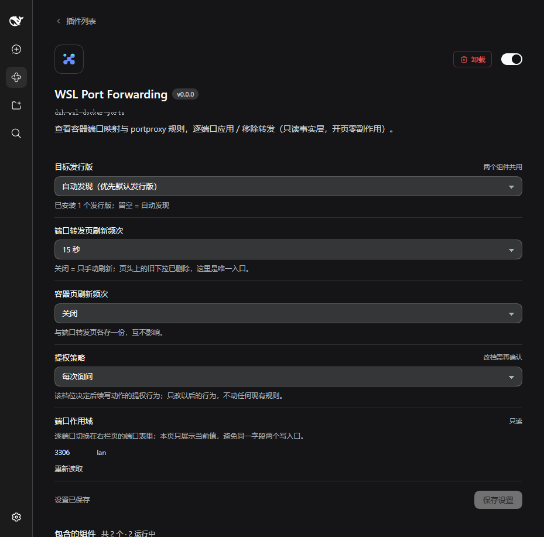
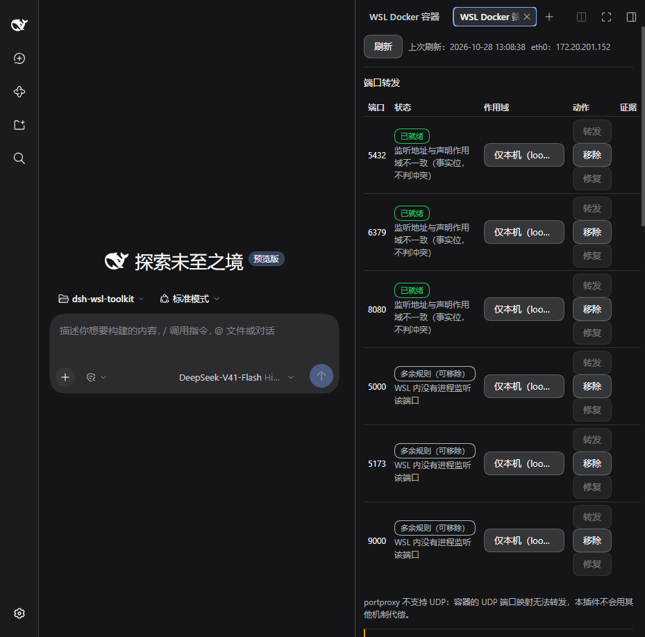
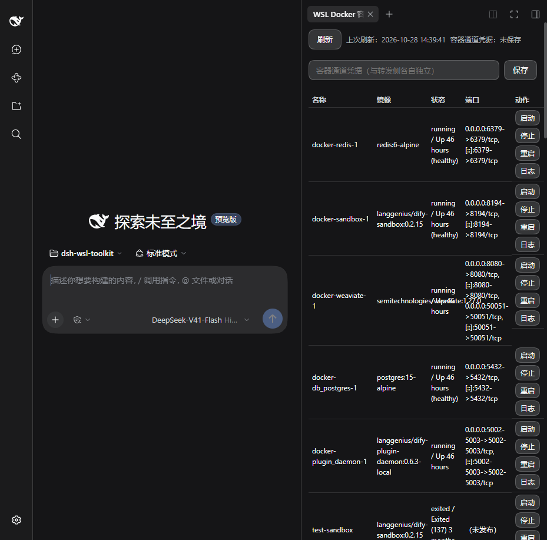

# dsh-wsl-toolkit

> DeepSeek Harness 的 WSL 工具集：**WSL Docker 端口转发管理 + 容器控制**（右栏两个组件）和**可配置受管终端**（真 PTY）。

Windows 上跑 WSL2 的人都会撞上同一堵墙：容器在 WSL 里监听着 `6379`、`8080`，Windows 侧却要靠 `netsh portproxy` 一条条手敲规则，敲错了还不知道错在哪，WSL 重启换 IP 后规则静默失效。这个插件套件干的事就是把这堵墙拆成**看得见、改得动、留得下证据**的一块块砖。

| 面 | 一句话 |
| --- | --- |
| **端口转发页** | docker 容器实际映射 ⇄ Windows `netsh portproxy` 规则，逐端口对照成**五种状态**（已就绪 / 缺少规则 / 多余规则（可移除） / 地址漂移 / 冲突（只报告、不可改）），一键应用 / 移除 / 修复漂移 |
| **容器页** | 列出 WSL 内容器（名称 / 镜像 / 状态 / 端口），启动 / 停止 / 重启 / 看日志，**零提权** |
| **受管终端** | profile（`name` / `command` / `args` / `env` / `cwd` / `cwdLinux`）驱动的真 PTY 右栏终端，屏幕快照 + 增量流，Agent 可读写 |
| **插件详情页** | 目标发行版、端口转发页刷新频次、容器页刷新频次、提权策略 —— 一个页面管住两个组件 |

---

## 界面

| 插件详情页（三个共用配置 + 提权策略） | 端口转发页（五态对照） |
| --- | --- |
|  |  |



---

## 功能

### 端口转发（`dsh-wsl-docker-ports`）

- **五态对照**：`已就绪` / `缺少规则` / `多余规则` / `地址漂移` / `冲突` —— 每格都带**判据**（如「多余规则 = WSL 内没有进程在监听该端口」，不是猜的）。
- **声明式所有权**：只动 `managedPorts` 集合内的端口。集合外的一律不碰、不计数、不出现在动作面（原脚本的 `portproxy reset` 会清空**他人全部规则**，这里从设计上就不可能）。
- **逐端口作用域**：本机（loopback，默认）或局域网**逐个显式 opt-in**；顺手能从 Windows 物理网卡里挑监听地址，不再全量 `0.0.0.0` + 防火墙放行。
- **eth0 漂移安全网**：`connectaddress` 指向 WSL eth0 IP，重启/重建后 IP 变了会标 `地址漂移` 并提供「修复漂移」；写入前强制现读，不拿缓存地址写规则。
- **写路径四步**：动作计划 → 变更预览 → 提权执行 → 审计留痕。凭据缺失一律 `401`，零执行、零写入。
- **提权**：非管理员运行，靠 UAC 辅助进程（`gsudo` 优先，回落 `Start-Process -Verb RunAs`）；提权失败以 `exit code 999` 回传，不静默降级。提权策略 `none` / `ask` / `passby`，默认 `none`。
- **明示不支持 UDP**：`portproxy` 本身不支持，界面直说不兜底（不悄悄换成别的手段）。

### 容器（`dsh-wsl-docker-containers`）

- 列表：名称 / 镜像 / 状态 / 端口 / 动作；`docker ps` 用 `--format '{{json .}}'` + 硬超时（裸 `--format json` 会挂住）。
- 启停重启 + 日志面板；容器通道凭据与转发侧**各自独立**。
- 页头「上次刷新：`YYYY-MM-DD HH:mm:ss`」；轮询拿到**同一份**数据时零重绘（不闪、不重置滚动）。
- 镜像列优先在 `/` 与 `:` 处折行（`<wbr>`），长串兜底断词，不越界压到状态列。

### 受管终端（`dsh-terminal-profiles`）

- profile 驱动真 PTY：`command` / `args` / `env` / `cwd`（Windows 路径）/ `cwdLinux`（WSL 路径）——`E:\x` 与 `/mnt/e/x` 语义不同，两个字段分开写。
- 屏幕模型（快照）+ 增量流**两者都给**，Agent 工具族 `managed_terminal_*`（`new` / `list` / `read` / `write` / `resize` / `kill`）。
- 配置页自绘表单，`live` 字段走 `ctx.settings`（不重挂载）、整体配置走 `configEditor`（会重挂载），只读态与 `revision` 冲突态都有明确文案。

---

## 硬前提

| 项 | 要求 | 不满足时 |
| --- | --- | --- |
| 宿主 | DeepSeek Harness **0.2.0-rc.2**（`cordis-4` 插件 API） | 兼容性预检置灰并写 stderr，本仓不自行绕过 |
| OS | Windows 11 + WSL2，且 **NAT 网络模式** | mirrored 下 eth0 语义改变 ⇒ 界面置灰 + 给修复指引，**不自动改** `.wslconfig` |
| 发行版 | 任意已安装发行版（本机验证用 `Ubuntu2204`）；自动发现，不手打 | 配置页下拉里选，或留空 = 自动发现 |
| Docker | 装在 **WSL 内**（非 Docker Desktop） | 容器页报错态 + 原文输出 |
| 权限 | **不需要**以管理员启动 | 写规则时才拉起 UAC 辅助进程 |
| Node（开发） | `>= 22.6.0` | — |

---

## 架构

```
                 profiles/<name>/package.json   ← 只有这一处「装了什么」
                              │
      dsh-wsl-docker-ports-bundle        （组合包壳：只声明卡片标题 + 两个组件行）
        ├── cordis.patch.yml  - insert: id=wsl-ports      name=dsh-wsl-docker-ports
        └──                     - insert: id=wsl-containers name=dsh-wsl-docker-containers
                              │
   ┌──────────────────────────┴───────────────────────────┐
   │ dsh-wsl-docker-ports（端口转发）   dsh-wsl-docker-containers（容器页）│
   │   Host：只读探针 / 写通道 / 提权    Host：docker ps 只读            │
   │   Client：主包 + 懒加载 chunk       Client：主包 + 懒加载 chunk     │
   └──────────────────────────┬───────────────────────────┘
                              │ 共享底座（非插件包）
        dsh-wsl-docker-core（schema 工厂 / 只读探针 / HTTP·凭据·健康·错误模型）
        dsh-wsl-shared    （发行版发现 / eth0 IP / 路径翻译 / NAT 判定 / 结构化命令执行）
```

| 包 | 类型 | 职责 |
| --- | --- | --- |
| `dsh-wsl-shared` | 库 | WSL 事实层：发行版发现、eth0 IP、`winToWsl`/`wslToWin`、NAT 判定、带超时的结构化命令执行 |
| `dsh-wsl-docker-core` | 库 | Docker 侧共享底座：schema 工厂、只读探针、HTTP / 凭据 / 健康 / 统一错误模型 |
| `dsh-wsl-docker-ports` | 插件 | 端口转发：只读事实层（docker + `netsh`）+ 提权写路径 + 五态 UI |
| `dsh-wsl-docker-containers` | 插件 | 容器页：列表 / 启停重启 / 日志，零提权 |
| `dsh-wsl-docker-ports-bundle` | 组合包壳 | 只做「一张卡 + 两个组件行」，实现全在上面两个插件里 |
| `dsh-terminal-profiles` | 插件 | 受管终端：profile 模型、真 PTY、屏幕模型、Agent 工具面、配置页 |

**客户端加载契约**（本仓最硬的一条）：宿主 `ModuleLoader` 只认 CJS bundle，页面必须能 `require.async` 拆分 —— 主包 **≤ 64 KiB 硬门**，页面渲染面与写路径内核进懒加载 chunk；每个包另有**只降不升**的字节棘轮。详见 [`client-contract.md`](./client-contract.md)。

**配置存活**：`live` 字段（刷新频次等）经 `ctx.settings` 写入后**不重挂载**、即时生效；`ordinary` 字段会真 remount。配置的落盘处**就是** profile 的 `cordis.patch.yml`，所以本仓**运行时绝不手写**该文件（自举风险）。

---

## 安装

> 两条路，按需要选：**A. 从 npm 装**（一行，适合只想用）；**B. `link:` 本地路径**（适合改源码，路径即版本）。

### A. 从 npm 装（`0.1.0` 起）

```powershell
dsh plugin --profile <name> add "dsh-wsl-docker-ports-bundle@0.1.0"
dsh --profile <name>
```

GUI 里「添加插件」直接输包名即可：

```
dsh-wsl-docker-ports-bundle
```

公共 npm 上的五个包（**无 scope**，`latest` = 0.1.0）：

| 包 | 作用 |
| --- | --- |
| `dsh-wsl-docker-ports-bundle` | **组合包壳**：装这一个就够（卡片标题 + 两行声明） |
| `dsh-wsl-docker-ports` | 端口转发组件本体 |
| `dsh-wsl-docker-containers` | 容器控制组件本体 |
| `dsh-wsl-docker-core` | 运行时核心（多锚点解析宿主 schemastery、探测解析等） |
| `dsh-wsl-shared` | 纯逻辑共享层（`wsl -l -v` / `netsh` 解析、路径翻译、错误模型） |

> 📌 **版本沿革**：2026-10-28 首次发布的 `0.1.0` 是坏的（`dsh-wsl-shared` / `dsh-wsl-docker-core` 当时是**源码包**，`exports` 指向 `src/*.ts`，装进 `node_modules` 后 Node 禁止类型剥离 `ERR_UNSUPPORTED_NODE_MODULES_TYPE_STRIPPING` ⇒ 插件加载即崩）。该版本已**整包删除**，现在 npm 上的 `0.1.0` 是**修复版**（shared/core 已编译为 `lib/`）。
>
> `dsh-terminal-profiles`（受管终端）**尚未发布**，目前只能走 B 路 `link:`。

### B. `link:` 本地路径（改源码即生效）

**① 装进某个 profile**（改 `~/.dsh/profiles/<name>/package.json`，`<ABS>` = 本仓 `packages/<pkg>` 的绝对路径，用正斜杠）：

```jsonc
{
  "dependencies": {
    "dsh-wsl-docker-ports-bundle":   "link:E:/NodeProjects/dsh-wsl-toolkit/packages/wsl-docker-ports-bundle",
    "dsh-terminal-profiles":          "link:E:/NodeProjects/dsh-wsl-toolkit/packages/terminal-profiles"
  },
  "dsh": {
    "profile": {
      "bundles": ["dsh-wsl-docker-ports-bundle", "dsh-terminal-profiles"]
    }
  }
}
```

`dependencies` 负责解析出真实目录，`dsh.profile.bundles` 负责把它当**插件行**装载（行 / 页 / 工具 / 路由都由这一条带起来）—— **两处都要写**。也可以用 CLI：

```powershell
dsh plugin --profile <name> add "dsh-wsl-docker-ports-bundle@link:E:\NodeProjects\dsh-wsl-toolkit\packages\wsl-docker-ports-bundle"
```

**② 装链接并重启**：

```powershell
pnpm install                 # link: 也要装，两条链接由它建
dsh --profile <name>         # 改 package.json 清单必须重启
```

（`--port` / `--no-open` 这类选项**由 profile 的 app 插件声明**：认才能用，不认会报 `unknown option` 且进程照起不监听 —— 拿不准就只用 `dsh --profile <name>`。）

（只改 `cordis.patch.yml` 时，`dsh.profile.patchReload: "live"` 会即时生效，不必重启。）

**③ 装成功的判据**（三条同时成立）：① 插件行出现在 profile 行列表；② 右栏多出「WSL Docker 容器 / WSL 端口转发」两个页 + 插件详情页；③ 宿主 stderr **没有** `disabling profile plugin`。

> ⚠️ 宿主加载的是 `lib/` **产物** —— 改过 `src/` 记得先构建再重载。
> ⚠️ 别把它装进你正在用的 profile 做实验；探针请用一次性 profile，用完还原。

**卸载**：删掉上表两处 + `pnpm install` ⇒ 行 / 页 / 工具 / 路由全部注销，profile patch 不留孤儿条目。

---

## 开发

```powershell
pnpm install
pnpm -r build          # tsc 产物 + esbuild → lib/client*.js（含 chunk 拆分）
pnpm -r typecheck
pnpm -r test           # vitest（单测）+ node --test（真机 fixture 离线契约）
pnpm -r check:exports  # 导出预算（每包运行时导出 ≤ 12，类型软阈值 25）
pnpm -r check:size     # 体积与行数（单文件 ≤ 400 行 SHALL；去注释 ≤ 40 KB 软指标）
```

🔴 **本机两处硬事实**（踩过，写下来省你一次排查）：

1. **`tsc` 与两套测试只在 Windows 侧跑** —— WSL 内 TypeScript 是 7.0.2 native preview，缺 `@typescript/typescript-linux-x64`，`tsc` 直接报 `Unable to resolve`。
2. **`pnpm run` 会顺带装依赖** —— pnpm 11 的 `verify-deps-before-run` 在每次跑脚本前自动 install 并写回 `pnpm-lock.yaml`，只改代码却动了 lockfile，看起来像依赖变更。想避开就直接调二进制：

```powershell
node --test --test-concurrency=1 "tests/**/*.test.ts"
node node_modules/vitest/vitest.mjs run
& node_modules\.bin\tsc.CMD -p tsconfig.json --noEmit     # .bin/tsc 是 POSIX 脚本，用 node 直跑会 SyntaxError
node packages/wsl-docker-containers/scripts/build-client.mjs   # 三个插件包各有这一支（纯构建，不碰 lockfile）
```

**验收姿势**：`vitest` / `node --test` 是离线契约，**真机还得看像素** —— 用 `chrome-devtools` MCP 起一个探针实例（`dsh --profile <probe> --port 4339x --no-open`），读 `?token=`、点开页、量 `getBoundingClientRect` / `getComputedStyle`、截图存档。每个结论都带命令退出码 + 文件 diff + 证据图。

---

## 质量门（全部脚本化，可当场复算）

| 门 | 判据 | 说明 |
| --- | --- | --- |
| `check:client` / `assert-client-split` | 客户端主包 **≤ 64 KiB**，且每包棘轮**只降不升** | 页面渲染面必须能进 `require.async` chunk |
| `check:exports` | 每包**运行时**导出 ≤ 12（类型不计，软阈值 25） | 类型导出编译后擦除，单独统计 |
| `check:size` | 单文件 **≤ 400 行**（SHALL）；去注释 ≤ 40 KB（软指标，只告警不静默放过） | 超限 = 拆 Spec 或拆文件，**不许抬阈值** |
| `check:borders` | 跨包「零交叉门」：core 3 包白名单，R1–R6 全绿 | 防插件包互相 import |
| `check:scope` | 剥注释后扫**越界领域词汇** | 范围严格等于 001 T6.2 的字面判据 |
| `check:host` | 宿主契约离线用例 | 宿主形态变了先在这里红 |

**容器包 2026-10-28 实测**：`node --test` **26/26**、`vitest` **5 files / 34 tests**、`tsc` ×3 全 0、`check:exports` 22/22、`assert-client-split` 14/14（主包 **31,165 B ≤ 31,324 B**）、`check:borders` 248 文件、`check:size` exit 0。

---

## 目录

```
.
├── packages/
│   ├── wsl-shared/                  # WSL 事实层（库）
│   ├── wsl-docker-core/             # Docker 侧共享底座（库）
│   ├── wsl-docker-ports/            # 端口转发（插件）
│   ├── wsl-docker-containers/       # 容器页（插件）
│   ├── wsl-docker-ports-bundle/     # 组合包壳（一张卡两个组件）
│   └── terminal-profiles/           # 受管终端（插件）
├── specs/                           # 001–017：需求 / 设计 / 任务 / 真机验收留痕
├── stack-decision.md                # 技术栈唯一真相来源（已冻结）
├── stack-decision-changelog.md      # 决策流水（每次拍板一行，含 How + 证据）
├── client-contract.md               # 宿主客户端加载契约与体积硬门
└── AGENTS.md                        # 协作规矩：门、状态流转、红线
```

---

## 文档导航

| Spec | 内容 |
| --- | --- |
| [001 共享底座](./specs/001-wsl-shared/README.md) | 发行版发现 · eth0 IP · NAT 判定 |
| [002 可配置终端](./specs/002-terminal-profiles/README.md) | 右栏受管终端（真 PTY） |
| [003 端口转发](./specs/003-wsl-docker-ports/README.md) | 管理器 + 端口转发可视化 |
| [004 Agent 工具面](./specs/004-terminal-agent-surface/README.md) | `managed_terminal_*` 工具族与沙箱权限 |
| [005 提权写路径](./specs/005-elevation-write-path/README.md) | UAC 辅助进程 · 声明式所有权 · 防火墙最小放行 |
| [006 路径翻译](./specs/006-path-translation/README.md) | Windows ↔ WSL 双向映射 |
| [007 终端配置页](./specs/007-terminal-config-page/README.md) | 自绘表单 · live 写入管道 · 冲突态 |
| [008 写入通道](./specs/008-write-transport/README.md) | 计划 → 预览 → 提权执行 → 审计 |
| [009 写入口 UI](./specs/009-write-ui/README.md) | 凭据生成 · 客户端确认 · 结果四态 |
| [010 容器控制](./specs/010-docker-container-control/README.md) | 容器启停 / 日志 / 配置页 |
| [011 主包瘦身](./specs/011-client-bundle-split/README.md) | 渲染面移入懒加载 chunk（≤ 64 KiB 硬门） |
| [012 监听地址](./specs/012-listen-address-select/README.md) | `listenAddress` 从物理网卡里选 |
| [013 多余规则判定](./specs/013-listener-based-extra/README.md) | 改按「WSL 内有没有服务在监听」 |
| [014 刷新频次](./specs/014-refresh-interval-config/README.md) | 自动刷新可配置 |
| [015 拆两个插件](./specs/015-split-ports-and-containers/README.md) | Docker 管理与端口转发独立开关 |
| [016 一张卡两个组件](./specs/016-one-card-two-components/README.md) | 组合包壳 + 组件行 |
| [017 组合包配置页](./specs/017-bundle-config-page/README.md) | 提权策略 / 刷新频次 / 目标发行版搬进插件内页 |

再加上 [`stack-decision.md`](./stack-decision.md)（栈的唯一真相来源）、[`stack-decision-changelog.md`](./stack-decision-changelog.md)（**110 条**决策流水，含「为什么不是另一个方案」与真机证据）与 [`AGENTS.md`](./AGENTS.md)（协作规矩）。

---

## 已知限制与下一步

- **不支持 UDP 转发**：`portproxy` 本身不支持，本插件不另找机制替代（也不假装支持）。
- **不改 `.wslconfig`**：非 NAT 模式只提示修复指引。
- **镜像管理 / `compose` / 进容器 `exec`**：留给下一期，注入点已预留（`exec` 会可选消费受管终端服务，缺失时按钮置灰并写明原因）。
- **只用一次真机验证过**（本机 Windows 11 23H2 + WSL 2.7.3 + `Ubuntu2204` + Docker 引擎 29.5.3）；别的发行版 / 网络模式的读数欢迎提 issue。

## 许可证

[MIT](./LICENSE) © 2026 VeronicaDavichi

随便用、改、商用、再分发，只要保留版权与许可声明；**不提供任何担保**。本仓所有包（`package.json` 的 `license` 字段）统一 MIT。
